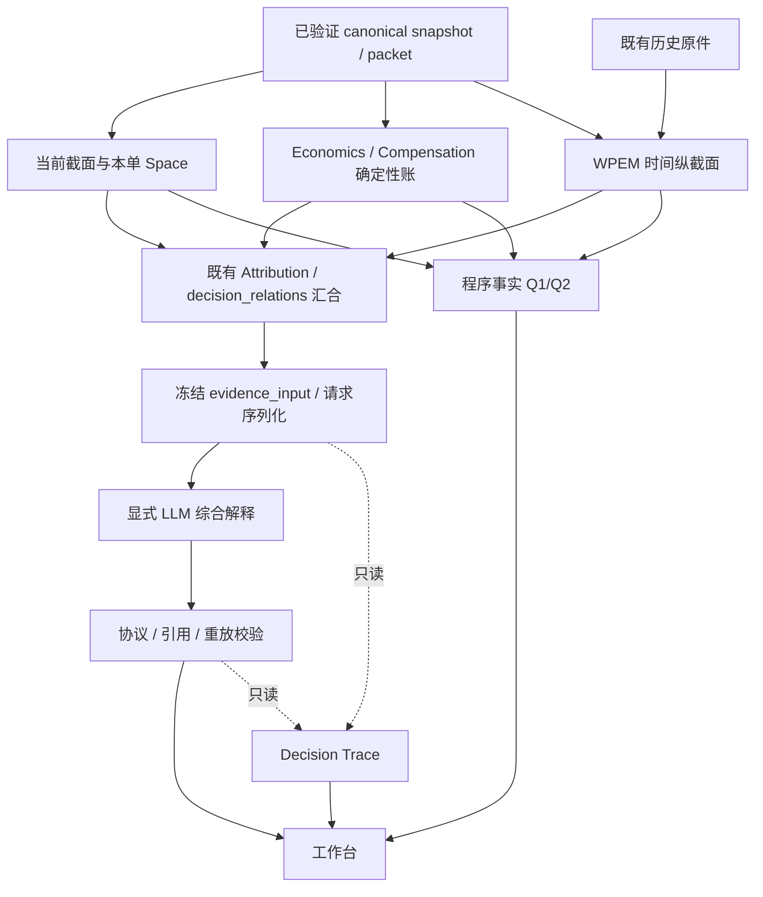

# v2.5.5 局部职责校正与解释基线回执

2026-10-06，UTC+8。用户直接要求“局部职责校正，矫正后再尝试 LLM 语义验收，补全解释基线”。本轮在已有 As-Is 审计上做局部改动，没有按附件展开全架构重构。

**职责校正已完成，已有一份真实响应通过独立语义审查和原文重放，形成可查看的冻结解释基线。最新截面的响应仍被拒绝，因此不宣称 LLM 已能稳定通过每次新市场样本。当前工作台保留最新失败和此前合格解释，两者身份分开。**

## 现在能看什么

入口：<http://127.0.0.1:8919/#reviewStateTitle>。本地版本 `OBSERVATION-2.5.5-9c6c705ccaf5`，运行于本工作树；没有提交、推送、tag 或远端部署。

- 当前 Put / Call 合同、公开盘口估算、费用、净信用、程序两问、当前空间状态、历史窗口与局部限制仍可阅读。
- 在“评审回执 → 此前有效评审 · 历史参考”查看已验收的模型 Q1/Q2。它绑定 **2026-10-06 19:01:07** 的真实冻结 Call：卖 86500 / 买 88500，2026-10-07 16:00 到期；实际模型响应于本轮取得，不把输入日期更新成响应日期。
- “本点依据与审计下钻”可核对该点实际 refs、事实、关系、来源时间及原字段；Decision Trace 可查看本次发给模型的内容、模型引用及未引用信息。
- 最新尝试绑定 **23:34:04** 的另一份真实冻结截面。页面显示拒绝及其冻结输入，不显示其失败解释，不把历史成功附着到当前候选。

模型在合格样本中解释了：Call 上涨责任；快窗口偏多与慢窗口中性；不完整主动流与合格 TMV 价格路径的不同用途；Skew 与价格路径的冲突；当前 Funding 未拥挤与不同窗口拥挤标签的口径差别；相邻报价中信用增加、费用不变，以及片段不能拼成完整趋势的原因。风险参考缺失只限制补偿充分性和正期望判断。

未被模型引用的 ETF、CP、OI、已实现损益、KPF 等内容没有删除，仍保留在实际输入和审计中；本轮不把全目录逐项复述作为验收条件。

## 局部职责校正

| 范围 | 实际改动 | 保留的边界 |
|---|---|---|
| A：当前截面与历史故障 | 当前合同、来源、原始报价先独立构造并校验 packet。历史 compose 失败时，用同一已验证 packet 生成 current-only evidence，保留原始报价可回放性。 | 坏当前 packet 仍阻断；不伪造 Delta/Path。历史错误写入既有审计信息，不新增市场准入状态。 |
| B：比较关系归属 | 既有 `decision_relations.evidence_relations` 持有确定性比较；WPEM `observed_fragment_relations` 持有片段比较。clean input 只读取、选择、压缩与绑定引用。 | 当前 2.6.5 缺少已归属关系会明确拒绝，不隐式重新计算；未新增独立 decision-evidence schema 或服务。 |
| C：构建一次 | `run_review` 构造一次 review input，发送阶段调用 `build_request_from_input`，复用该冻结对象并验证身份与 hash。 | validator/store 的独立重建、篡改检测仍保留；验收脚本的独立重放不算运行发送阶段重复构造。 |
| D：事实共享与兼容 | 当前路径共用 `_build_review_facts`，不先完成 legacy 全投影再覆盖为新输入。 | 历史 2.6.4 真实样本可按原版本字节等价重建；更早协议分支保留。 |
| E：调度与旁路 | 保留现有线程模型，局部隔离历史故障；审计仅从冻结输入及已接受结果派生。 | 不增加队列、异步框架、Review→Upstream 依赖或 Audit gate。刷新不会自动调用 LLM。 |

主要位置：`tools/astra_workbench_v20.py::_attach_wpem`、`tools/astra_wpem_workbench_v1.py::current_only_evidence/require_current_package_binding`、`tools/astra_underwriting_review_v20.py::_build_review_facts/build_request_from_input/run_review`、`tools/astra_wpem_product_review_v1.py::compose_decision_evidence/_relation_for_ref/_clean_evidence_package`。



图示为数据消费关系，不表示所有组件严格串行 hard dependency。真实刷新编排仍会等待同步 compose；本轮隔离故障，不宣称已解决所有性能耦合。程序两问没有进入模型作为预写答案，模型两问也不反向生成程序事实。

## 真实调用与语义验收

当前输入 `review_input@2.6.5`；输出沿用 `evidence_points@2.6.4`；最终提示版本 `evidence_synthesis_prompt@1.0.2`；旧 2.6.4 提示版本仍为 1.0.0。继续使用既有 DeepSeek 配置、实际响应模型 `deepseek-flash`、共享调用账本；本轮共 3 次真实 HTTP，无自动重试。

| 保存样本 | 实际结果 | 最终处理 |
|---|---|---|
| `realigned_baseline` | 原严格校验拒绝；独立审查另外发现未引 WPEM gap、跨点漏引 TMV，以及部分资格主动流被写成共同压力。 | 保留原始响应和拒绝回执，不展示正文。 |
| `semantic_followup` | 独立语义审查通过；原校验器把“不与主动流交叉确认”误认成引用主动流事实。 | 修复明确的误报后，用**完全相同原始响应和输入**重放通过，未增加 HTTP。单独保存 `REVALIDATION_RECEIPT.json`，原拒绝文件保持原样。作为冻结解释基线展示。 |
| `current_observation` | 23:34:04 最新冻结截面；响应含多余顶层 `type: json_object`，严格拒绝。 | 不删字段、不清洗成成功；页面保留失败输入，历史合格解释折叠可达。另记录 Funding 当前/窗口口径混同，以及局部窗口被写成共同前提的语义风险。 |

提示补充只针对真实观察到的问题：逐点比较双方引用、部分资格主动流的语义强度、WPEM gap 的含义、不同窗口口径的冲突。模型返回的文字与引用没有人工改写。

校验器修复也只针对明确误报：

1. “已实现补偿”是报价/成交语境，不能仅因“已实现”三个字要求链上 `map.realized`；明确的已实现损益、盈亏等陈述仍须引用对应事实。
2. 很窄的“不与主动流交叉确认”方法边界不主张主动流读数；同一点如果另外断言“主动流快窗偏多”，没有 `flow` 仍拒绝。

独立 reviewer 检查了上述修复及真实原文。没有把格式通过当成语义通过，也没有为了最新失败放宽输出 schema。

## 验证与审计原件

证据根目录：`.artifacts/topology_realignment_20261006_01/`。

- `TOPOLOGY_FREEZE.json`：进入语义阶段前的源码身份、独立审查结论和当时 0 次 HTTP。
- `TOPOLOGY_REGRESSION.txt`：受影响核心链路 117 项回归通过；原始报价 packet 保留修复后另跑 4 项通过。
- 语义修复阶段：20 项 pipeline/语义反例回归通过；最终代码的构建复用、当前截面降级、前端与校验反例共 41 项通过，见 `FINAL_REGRESSION.txt`。测试计数不证明模型经济有效性。
- `samples/*/actual_llm/`：实际请求、出站字节、provider 原始 HTTP 字节、原文、解析结果与传输/验证回执。每份成功或失败均保留；私有凭据未写入这些文件。
- `samples/*/SEMANTIC_REVIEW.json`：独立语义结论；第二份另有 `REVALIDATION_RECEIPT.json`，证明未改原文、未额外调用。
- `DISPLAYED_ACCEPTED_RECEIPT.json` 与 `DISPLAYED_RECEIPT.json`：本地页面分别使用的历史合格回执和最新失败回执。
- `BROWSER_QA.json`、`observation_receipt.jpg`：实页走查、逐点来源和只读 Trace 检查。页面 console 未见 error。
- `BEFORE_FILES.json`、`AFTER_FILES.json`、前后 manual_review 备份：限定本轮回退范围，保留继承的脏工作树。

浏览器实际核对了当前总览、最新拒绝身份、历史解释冻结时间、Q1/Q2、flow 的快慢窗口原读数、来源时钟限制、公开输入字段及 Decision Trace。没有重做页面审美方案。

## 仍在的限制与后续具体问题

- **模型稳定性尚未闭环**：已有可接受样本，但最新样本被正确拒绝。不要把本轮基线描述为每次都能产出合格解释，更不代表有效交易策略。
- **本地按钮没有 provider 配置**：8919 复用现有只读观测服务，`api_key=None` 且未挂共享调用账本，因此“解释本单观测资料”按钮仍关闭。本轮真实调用经既有受控验收入口执行，再把有完整原件的回执接回现有展示机制；没有验证“8919 点击按钮→provider”的正常服务调用闭环。
- μ/M 仍缺失，严格 WPEM 窗口仍可不足。引用和有限语义检查不证明因果、概率、补偿充分性或执行许可。
- 当刷新中上游身份变化，既有 `candidate_gate_version_changed_during_refresh` 仍可出现。不能把混版本资料强行送入模型。
- 同步历史 compose、私有 proof 中的重复源绑定和较大回放体积仍存在；本次最新完整 proof 的格式化文件约 119 MB，现有 gzip 端点可读取。后续应依据实际刷新耗时和审计访问问题再修剪，不引入新调度框架。
- `compose` 的较宽异常分支会把多类内部问题归入历史隔离，已保留原始错误类型；更细的归因只记录为下轮审计点。
- 兼容目录和旧协议分支仍承担本地安全归一化/历史回放，不能因为不发给模型就整组删除。后续清理必须先证明无有效入口依赖。
- 下轮语义调整只针对本轮已出现的三个具体问题：额外输出字段、当前 Funding 与 TMVF 窗口定义混同、局部资料缺口被写成共同前提。不再以理论完整性扩模型或状态。

## 开始观测与回退

1. 打开 8919，先看当前合同、资料时间及程序两问；把结构门和风险限制与事实可读性分开。
2. 到“评审回执”，最新失败看“本次冻结输入审计”；已验收解释看“此前有效评审 · 历史参考”。先核对其 **19:01:07** 冻结时间，再读 Q1/Q2。
3. 对关心的解释点展开“本点依据与审计下钻”；需要更完整证据时打开 Decision Trace 和程序核算。不要把历史解释直接套在已变化的当前报价上。

局部回退脚本为 `.artifacts/topology_realignment_20261006_01/rollback.py`，默认只核查，不修改：

```powershell
# 在本工作树执行；默认 dry run
& 'C:/Users/Xu/AppData/Local/Programs/Python/Python312/python.exe' .artifacts/topology_realignment_20261006_01/rollback.py
# 确需回退本轮时加 --apply，然后重启同一 serve_current.py
```

脚本逐文件比对交付后 hash，检查 manual_review 是否被后续工作改动；冲突会停止。应用时先留可恢复备份，只还原本轮文件与回执指针，不重置 Git、不删除行情历史或真实 LLM 原件。运行入口仍是 `.artifacts/observation_baseline_20261006_01/serve_current.py`；如重启，先核对 8919 对应进程，再以同一工作树和 Python 启动。

本轮由 explorer 核对故障边界与职责归属，三个 worker 分别实现当前截面隔离、关系归属和构建复用，reviewer 独立复核代码与真实模型语义；主 agent 检查差量、修复原始报价保留问题、运行回归、保留真实原件并完成页面验收。
