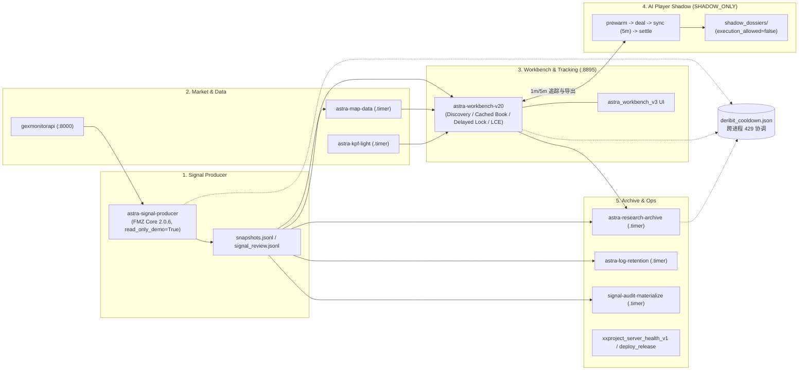

# A｜现役架构基线、五域收敛与 FMZ 职责清单（As-Is & Target Matrix）

**裁决结论：** `xx-eu` 当前生产基线为 `6311071c887433efb5a9b754290a1d8050caa0d8`（`codex/deribit-rest-pacing`，含 REST 调频、archive 去重、并发视图隔离与 `PENDING_LOCK`/`DELAYED_LOCK` 修复，已合流进本迁移分支）。全网仅保留 1 个现役 FMZ 信号进程（`xxproject-fmz-node-69494805.service`，托管 bot `668422` 运行只读核心 `neutral_regulation_demo_fmz.py` `2.0.6`）；仓库内手工执行脚本 `spm_manual_gate_execution_fmz.py`（`3.0.0-manual-gate`）及相关 bridge/worker 未启用且零消费者，继续隔离归档。

---

## 1. 服务器原生五域收敛架构与数据流

所有现役生产代码收束为单一权威发布树（`/opt/xxproject/current`）与 **21 个统一 `systemd` unit**，运行时状态与密钥完全剥离至 `/var/lib/xxproject/`、`/opt/astra-map-data/state/`、`/var/lib/astra-kpf-light/` 与 `/etc/`：

| 责任域 | 权威代码与入口 | 统一 `systemd` Units（共 21） | 核心职责与消费关系 | 安全与失败边界 |
| :--- | :--- | :--- | :--- | :--- |
| **1. Signal Producer** | `signal_core/neutral_regulation_demo_fmz.py` (`2.0.6`) + `tools/astra_signal_producer_v1.py` | `astra-signal-producer.service` (1) | 采集 Binance/Deribit/GEX/Macro，计算中性回路因子与 NR 状态，原子输出 `snapshots.jsonl`、`signal_review.jsonl`、`producer_health.json` | 强制 `read_only_demo=True`；共享 `astra_deribit_cooldown_v1` 429 冷却；`Type=notify` + 检查点断电恢复 |
| **2. Market & Data** | `05_GEX监控API_.../gexmonitorapi`、`astra_map_data_server_v24.py`、`astra_kpf_light_v1.py` | `gexmonitorapi.service`、`astra-map-data.{service,timer}`、`astra-kpf-light.{service,timer}` (5) | 提供 `127.0.0.1:8000` GEX API、5m `current_map.json`（内置 `data_engine`）、每日闭日 `KPF published/current.json`（48h 有效窗） | KPF 打包前置校验 `source_manifest.json` 字节哈希；各数据源独立降级 |
| **3. Workbench & Tracking** | `tools/astra_workbench_v20.py` + `deploy/astra_workbench_v3/` | `astra-workbench-v20.service` (1) | 常驻 `127.0.0.1:8895`（Nginx `auth_request` 对外）；生成双边候选、`case-file`、1m `lce_*` 追踪、`_cached_book`、后台 `retry_pending_shadow_locks` 与 `/shadow-tracking/export`（32 MB 上限） | 共享 `deribit_cooldown.json`；严格受控 Token 鉴权；`execution_allowed=false` |
| **4. AI Player Shadow** | `astra_player_{dossier_v1,tracking_v13,input_v1,condition_v1}.py` + `astra_anchor_relative_v1.py` | `astra-player-{prewarm,deal,sync,settle}.{service,timer}` (8) | 15:52Z 预热、`16:02–17Z` 每日发牌与自动 `PENDING_LOCK->DELAYED_LOCK` 追踪、每 5m 固定钟 `sync-open` + 持仓复核、次日 `08:06Z` 官方交割核算 | 计划文件 `plan.daily_r16.v2.json` 强制 `mode="SHADOW_ONLY"`, `execution_allowed=false` |
| **5. Archive & Ops** | `astra_research_archive_v1.py`、`astra_data_retention_v23.py`、`materialize_signal_cards.py`、`xxproject_server_health_v1.py`、`deploy_release.py` | `astra-research-archive.{service,timer}`、`astra-log-retention.{service,timer}`、`signal-audit-materialize.{service,timer}` (6) | 10m 结构/路径/成交归档、5m `.gz` 保留清理、事件卡物化（`SESSION_CONTEXT_REQUIRED=1`）、全栈只读健康自检、原子安装/回滚 | `signal-audit-materialize` 读 `/var/lib/xxproject/signal_native/logs`；单命令回滚保留状态与 `/etc` |

---

## 2. 现役生产基线对照与退役清理裁决

| 资产 / 服务名 | 当前生产实际 | 原生化收敛处置 |
| :--- | :--- | :--- |
| `/opt/signal-audit-tools/`、`workbench-v20.py`、`research_archive_v1.py`、`player_tracking_v13.py`、`discovery_v20.py` | 精确匹配 `6311071c` SHA-256；其余散落 6 个 `/opt/*` 目录 | 收敛至 `/opt/xxproject/releases/<id>`，由 `/opt/xxproject/current` 符号链接统一指向；切换稳定前暂保留旧 `/opt/*` 供 Scenario B 秒级退回 |
| `xxproject-fmz-node-69494805.service` (bot `668422`) | 现网唯一运行中的 FMZ 信号生产者 | 切换时**先停 FMZ 再启 `astra-signal-producer`**，避免同 IP 竞争 Deribit REST 配额；确认稳定后正式退役 |
| `astra-data-engine-maintenance.{service,timer}` | 每 5m 在 `/opt/astra-data-engine-v23` 维护第 3 份无读者 `DataEngine` 存储 | **切换时停用并禁用**：保留 `astra-log-retention.{service,timer}` 专注 `>.gz` 清理，消除重复存储写入 |
| `xxproject-observation-canary.{service,timer}` | `v2.6.3-stage.2` 临时 FMZ 观测量探针 | **切换时停用并禁用**：原生链路已由 `astra-signal-producer` + `xxproject_server_health_v1.py` 取代 |
| `spm_manual_gate_execution_fmz.py` / `xxproject-fmz-node-115167519` | 未运行、零消费者 | **严禁打入发布包**（`build_release.py` 构建门禁强制拦截），留仓静默归档 |

---

## 3. FMZ 与相关生产职责逐项对照

| 功能模块 | 原生产者 | 消费端 | 原生接管方案 |
| :--- | :--- | :--- | :--- |
| 现货成交/量柱/CVD/Anchor/TMV-F/M-DIE/NR/SpaceGate/EDB/Skew/Macro | Bot `668422` (`2.0.6`) | `workbench`, `map-data`, `wpem` | 原样导入未修改 `neutral_regulation_demo_fmz.py`，由 `astra_signal_producer_v1.py` 托管（含 1m K 线回补与检查点） |
| 原生审计卡与 23:00 BJT 固定轮 | Bot `668422` | `signal_llm_review`, `signal-audit-materialize` | 持久化 `seen_episode_ids`/`seen_fixed_round_slots` 防重，保持 `SignalSessionPremiseDurabilityContext@1.0.0` 与 `record_hash` |
| FMZ 宿主接口 / 看门狗 (`Log`/`Status`/`Chart`) | FMZ Node `69494805` | 运维观测 | `systemd Type=notify` (`WatchdogSec=300`) + `journald` + `producer_health.json` |
| Deribit 限流保护 | 各进程独立退避 | `signal`, `workbench`, `research_archive` | 统一读写 `ASTRA_DERIBIT_COOLDOWN_FILE`（`astra_deribit_cooldown_v1.py`）并在 `refresh_quote` 转发真实抓取错误 |
| 静态审计物化 (`signal-audit-materialize`) | `/etc/systemd/system/signal-audit-materialize.*` | Nginx `/signal-audit/`（已 302 指向 v3）及审计 JSONL 校验 | **纳入 21 个统一 unit**；配置 `/etc/signal-audit/signal-audit-materialize.env` 从 `/var/lib/xxproject/signal_native/logs` 读取原生流，持续验证 `SESSION_CONTEXT_REQUIRED=1` |
